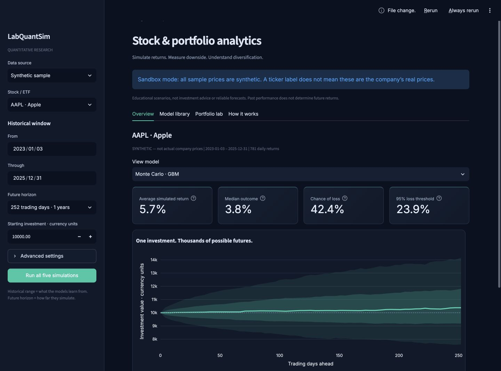
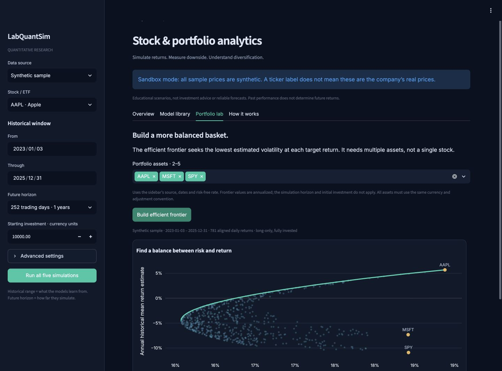

# LabQuant

### Understand the risk. Explore the return.

Quantitative stock simulation, risk analysis, and portfolio optimization explained in plain English.

> Try it here: **[Launch LabQuant](https://labquant.streamlit.app)**

  

**LabQuant** is an interactive quantitative finance research dashboard that turns historical stock prices into possible future scenarios. It brings simulation, downside-risk analysis and portfolio diversification together with explanations designed for people without a quantitative-finance background.

> **This is the public showcase repository. The application source code is maintained in a separate private repository and is not included here.**

## What you can do

**LabQuant helps people explore a stock’s potential returns and risks using historical prices.** It shows a range of possible outcomes rather than how much someone is guaranteed to earn.

Users can:

- **Choose a stock and historical period** to analyze.
- **Set an investment amount and future horizon**, such as investing $10,000 for one year.
- **Compare five simulation models**, including Monte Carlo and historical sampling.
- **See average and median simulated returns**, along with a range of possible ending investment values.
- **Understand downside risk**, including the modeled chance of losing money, adverse scenarios, volatility and drawdowns.
- **Compare portfolios of 2–5 assets** to explore how diversification changes estimated risk and return.

For example:

> *If I invest $10,000 in Apple for one year, what outcomes do these models suggest, and how much could I gain or lose?*

LabQuant uses real historical prices for stock analysis. A synthetic sample mode is also available for demonstration. Results depend on the selected historical period and model assumptions, so they should be treated as educational scenarios rather than reliable forecasts.

## A look inside

The screenshots below show the actual local Streamlit application running **synthetic sample data**, not live stock forecasts.

## Features

- Select a stock or ETF and choose the historical period to study.
- Set a separate future horizon and compare five simulation models.
- Explore percentile bands, simulated returns and the probability of a loss.
- Inspect Value at Risk, expected shortfall, volatility, Sharpe ratio and historical drawdown.
- Compare portfolio allocations along an efficient frontier for two to five assets.
- Review correlations to understand diversification.
- Import daily-price CSVs and export reproducible reports.
- Use synthetic sample mode without an account or a paid data connection.
- Optionally request free historical data and view a separate TradingView reference chart.
- Read short explanations and limitations beside the results.

The **private GitHub repository** contains the Python application, quantitative models, tests and dependencies. Streamlit Community Cloud deploys that repository as a **public website**, while the source code remains private. This public showcase repository contains documentation and presentation assets only.

## Tech stack

| Layer | Technology |
| --- | --- |
| Application | Python, Streamlit |
| Numerical analysis | NumPy, pandas, SciPy |
| Interactive charts | Plotly |
| Optional historical data | yfinance / Yahoo Finance |
| Reference market chart | TradingView widget |
| Quality checks | pytest, Streamlit AppTest |
| Hosting | Streamlit Community Cloud |
| Source hosting | Separate private GitHub repository |

No paid hosting, database or paid API is required for the sample/CSV experience. Free market-data availability and data-use rights are separate considerations.

## Methodology overview

**Monte Carlo / geometric Brownian motion** explores randomized price paths based on historical average daily movement and volatility. It is an interpretable baseline, but its stable-distribution assumptions are strong.

**Historical bootstrap** rearranges sampled days from the selected history. It reflects the sample's observed distribution but cannot invent daily shocks that are absent from it.

**Block bootstrap** resamples short stretches of history to retain some short-term dependence and periods of market turbulence.

**Student-t stress scenarios** explore heavier-tailed shocks. The model's average terminal price is unstable; median and percentile outcomes are more informative than its finite-run mean.

**GARCH-style volatility scenarios** allow risk to change after shocks. This version uses illustrative fixed parameters, not a statistically fitted GARCH forecast.

**Efficient frontier analysis** estimates the lowest-volatility, fully invested, long-only portfolio at each target return. It uses shared historical dates and estimated correlations. The reported highest-Sharpe allocation is selected from the displayed frontier points.

All models are conditional on their inputs and assumptions. Agreement between models is not independent evidence: they reuse the same history. Percentile bands describe simulated variability, not certainty about future stock performance.

## Roadmap / Future updates

- [x] Python/Streamlit research dashboard
- [x] Five simulation models and model explanations
- [x] Downside-risk measures and interactive charts
- [x] Efficient frontier, allocations and correlations
- [x] CSV import, reproducible reports and numerical tests
- [x] Publish the first public Streamlit deployment
- [ ] Add walk-forward evaluation and parameter uncertainty
- [ ] Fit and validate volatility-model parameters
- [ ] Expand currency and corporate-action handling
- [ ] Improve accessible chart summaries and data-quality diagnostics

## Data and privacy

Synthetic sample data is explicitly labeled. CSVs are processed in app-server session memory and are not deliberately saved to disk or shared through a global cache. Do not upload confidential portfolio/account information. Reports include the input prices, so users should share them only when permitted.

The optional Yahoo connector is unofficial and may be unavailable or rate-limited on shared hosting. The yfinance documentation notes personal-use data restrictions; no public redistribution license is implied. Sample and user-provided CSV analysis remain available independently. TradingView is an independent reference chart and does not feed the simulation calculations.

## Disclaimer

LabQuant is an educational research project created by me (Ravan Akhundov), not financial advice, a reliable forecasting service, or an automated trading system. Historical performance does not guarantee future results. Models can omit structural changes, liquidity, fees, taxes and events absent from the sample. No recommendation to buy or sell any security is made.

## Repository scope

This repository intentionally contains only this README and screenshots/architecture artwork. It contains no application source, Python modules, simulation implementation, tests, dependency files, secrets, market-data dumps or source archives.
